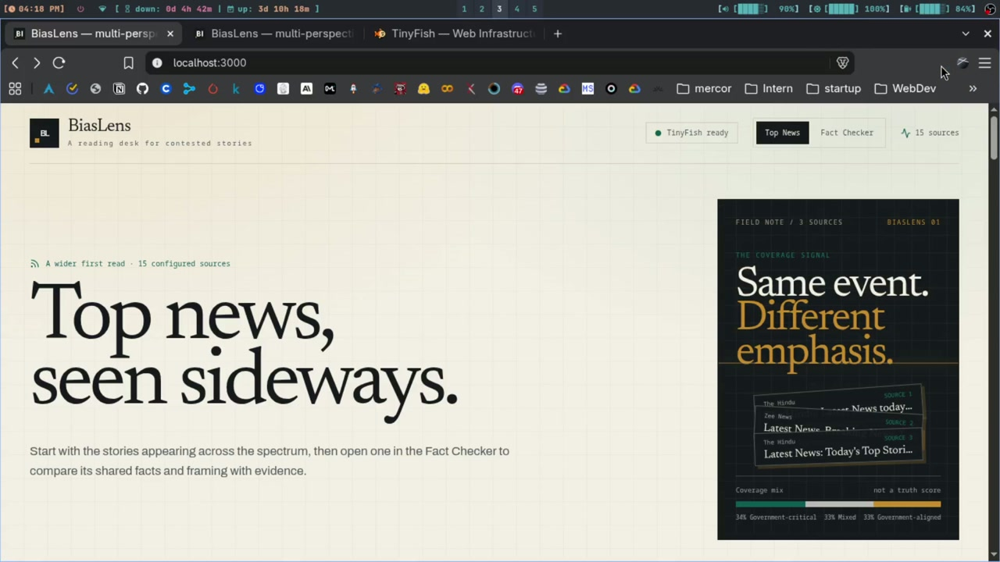

# BiasLens

## See the story behind the story.

<p align="center">
  <a href="artifacts/biaslens_demo.mp4">
    
  </a>
</p>

<p align="center"><strong>▶ Click the thumbnail to play the 2:50 walkthrough</strong></p>

One event can become fifteen different headlines. BiasLens lets you compare
those headlines without pretending that one model can produce a perfectly
objective version of the news.

Give BiasLens a topic or a public news URL. It searches a fixed cross-spectrum
source set, reads the accessible coverage, extracts the facts that overlap,
and then shows where the framing changes. Every meaningful result stays tied
to an original article and a short quoted excerpt.

> **The pitch:** BiasLens turns “Who should I believe?” into a more useful
> question: **“What do these outlets agree on, how are they framing it, and
> what coverage can actually be verified?”**

## Why this is different

Most news tools collapse many sources into one summary. BiasLens keeps the
disagreement visible.

| The reader sees | What BiasLens does |
| --- | --- |
| A wider first read | Top News finds story bundles appearing across the configured source set. |
| Shared facts | The consensus core shows facts reported by **N of M outlets**. |
| Framing differences | Each accessible article gets a model-estimated frame, persuasion signals, entity roles, and slant estimate. |
| Source accountability | Facts and analysis items include an article link and a verified excerpt of no more than 25 words. |
| Coverage boundaries | A blind-spot notice appears only after outlet search and on-site search checks pass. |
| Honest uncertainty | Blocked pages, failed fetches, invalid model output, and inconclusive absence checks remain visible as unavailable or inconclusive. |

BiasLens does not label an outlet as “ignoring” or “hiding” a story. It reports
what was found for the configured outlets and time window.

## The 90-second demo

> 🎥 **Watch the walkthrough:** [Play the MP4](artifacts/biaslens_demo.mp4) · [download the original MKV](artifacts/biaslens_demo.mkv)

### 1. Start with the news, not a blank input

Open the **Top News** page at `/`. BiasLens uses TinyFish Search to look across
15 configured outlets and groups similar headlines into story bundles. Each
bundle includes a source trail and a coverage bar:

```text
Government-critical  20%  |  Mixed 40%  |  Government-aligned 40%
```

That bar is a map of which source groups covered the bundle. It is **not** a
truth score, quality score, or claim that one group is more correct.

### 2. Pick one story to investigate

Select **Check this story**. The app opens the Fact Checker at `/analyze` with
the story already loaded. You can also paste a topic or a public article URL
directly into the workbench.

### 3. Show the live web work

The activity panel makes the retrieval visible instead of hiding it behind a
spinner:

```text
TinyFish: live web
  The Hindu       searching → reading → analyzed
  The Wire        searching → reading → analyzed
  Reuters India   searching → reading → analyzed
  ...

Pipeline: anchor → search → fetch → analysis → consensus → coverage check
```

TinyFish performs the finding, reading, and coverage checks. The LLM is used
after retrieval for structured relevance, claims, consensus, and framing.

### 4. Land on the consensus fact core

The result starts with the event anchor and the facts reported across outlets.
Each fact shows its outlet count, source links, and a representative excerpt.
This is the part of the story with the strongest cross-source support—not a
single “objective summary.”

### 5. Compare the frames

Open the per-outlet analysis to see how the same event is presented differently:

- dominant media frame;
- model-estimated slant direction and score;
- persuasion techniques;
- entity roles;
- exact evidence spans from the article.

The labels are estimates. The quotes and links are the audit trail.

### 6. End with the limitation

If the coverage check supports a possible blind spot, BiasLens says exactly
which search checks were performed and how many outlets in the group covered
the event. If the check is incomplete, it says **inconclusive** instead.

That last step is the product’s point of view: coverage absence is useful only
when the evidence for absence is strong enough.

## How it works

```text
Topic or public URL
        │
        ▼
Event anchor ──► short canonical query
        │
        ▼
TinyFish Search ──► one domain-aware search per outlet
        │
        ▼
TinyFish Fetch ──► article text held in memory only
        │
        ▼
Structured LLM stages
  relevance → claims → consensus → framing
        │
        ├──► source-linked evidence cards
        └──► verified outlet coverage checks
```

Every LLM stage returns strict JSON validated with Zod. Invalid output is
retried once and then marked unavailable; it is never silently guessed.
Transient search, fetch, and analysis results are cached by query, URL, or
content hash so a demo can continue when a live provider is unavailable.

## The source lens

The current registry contains 15 Indian and India-focused outlets:

- **Government-critical:** The Hindu, The Indian Express, NDTV, The Wire,
  Scroll, Brut India, Newslaundry, The Caravan
- **Mixed:** Reuters India, Press Trust of India, BBC News India
- **Government-aligned:** Zee News, The Times of India, Republic World,
  India Today

The code keeps `left`, `center`, and `right` keys for schema compatibility, but
the interface uses the more precise labels above. These are third-party seed
ratings used to describe the source lens—not ground truth about an article.

## Run it locally

### Fastest path: prepared replay

The repository includes derived demo results, so the interface can be explored
without making a live API call.

```bash
npm install
npm run check
npm run warm-demo
npm run dev
```

Open [http://localhost:3000](http://localhost:3000), choose a prepared story in
the Fact Checker, and run the replay. The replay contains URLs, titles, short
excerpts, labels, and the activity trail—not full article text.

### Live path: TinyFish + an OpenAI-compatible LLM

```bash
cp .env.example .env.local
npm run probe        # TinyFish Search + Fetch smoke test
npm run dev
```

Set the following server-side values in `.env.local`:

```env
TINYFISH_API_KEY=your_tinyfish_key
LLM_BASE_URL=https://openrouter.ai/api/v1
LLM_API_KEY=your_openrouter_key
LLM_MODEL=your_openrouter_model
LLM_REASONING_EFFORT=none
LLM_MOCK=0
TINYFISH_SCREENSHOTS=0
```

Any provider that supports an OpenAI-compatible `/chat/completions` endpoint
can be used. Keep keys server-side: never commit `.env.local` or expose a key
through `NEXT_PUBLIC_` variables.

After a successful live run, capture a safe replay for the demo:

```bash
npm run capture-demo -- my-story "your story topic"
npm run warm-demo
```

## Useful commands

| Command | Purpose |
| --- | --- |
| `npm run dev` | Start the Next.js development server |
| `npm run check` | Run TypeScript, ESLint, and config validation |
| `npm run build` | Create the production build |
| `npm run probe` | Smoke-test TinyFish Search and Fetch |
| `npm run probe:agent` | Exercise the optional TinyFish Agent flow |
| `npm run warm-demo` | Validate the committed replay fixtures |
| `npm run capture-demo` | Save one completed SSE run as a derived replay |

## Routes worth seeing

| Route | What it demonstrates |
| --- | --- |
| `/` | Top News: cross-spectrum story bundles and source trails |
| `/analyze` | Fact Checker: live/replay analysis workbench |
| `/api/health` | Integration status, source counts, and thresholds |
| `/api/top-news` | Cached or live Top News feed |
| `/api/analyze` | Typed Server-Sent Events analysis stream |
| `/api/tinyfish/search` | Server-side TinyFish search adapter |

## Trust and safety boundaries

- Only public pages are searched and fetched.
- No logins, paywalls, CAPTCHA solving, or access-control bypasses.
- Full article text is analyzed in memory and is not committed to the repo.
- Stored demo data is limited to URLs, titles, short excerpts, and derived labels.
- Every evidence excerpt is checked as an exact substring of its source text and
  is capped at 25 words.
- A failed or blocked fetch is not treated as evidence that an outlet omitted a
  story.
- Results apply only to the configured outlets, event, and search window.

## Engineering status

The MVP path is implemented: Top News, cached replay, typed SSE activity,
TinyFish Search/Fetch integration, structured LLM stages, consensus, framing,
and verified coverage checks. `npm run check` and `npm run warm-demo` are the
local correctness gates.

Before deploying publicly, validate the production build in the target host.
The current development environment reports a Next.js Turbopack child-process
permission failure during `npm run build`, while typecheck, lint, config
validation, and the prepared demo pass.

## Project shape

```text
app/                    Next.js pages and route handlers
components/             Top News, navigation, and Fact Checker UI
config/                 Outlet registry and thresholds
lib/analysis/           Anchor, retrieval, evidence, consensus, framing
lib/tinyfish.ts         TinyFish Search, Fetch, Agent, and absence checks
lib/top-news.ts         Cached cross-source Top News feed
lib/llm.ts              OpenAI-compatible structured-output client
data/demo/              Committed derived replay fixtures
data/cache/             Gitignored runtime cache
prompts/                Versioned prompt notes
schema/                 Event anchor JSON Schema
.opencode/skills/       BiasLens build and demo guardrails
```

The authoritative product constraints live in
[`BIASLENS_BUILD_SPEC.md`](./BIASLENS_BUILD_SPEC.md). The implementation skills
in [`.opencode/skills/`](./.opencode/skills/) define the evidence, wording,
TinyFish, and demo rules used by the project.
